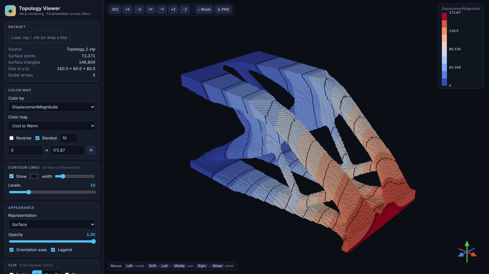

# Topology Viewer — vtk.js + ParaViewWeb

A web dashboard that loads the supplied topology-optimisation result (`Topology_1.vtk`,
a 160 × 80 × 80 hexahedral mesh, 156 k cells), renders it with **vtk.js**, and lets you
slice / clip / contour the *full volume* remotely through a **ParaViewWeb (wslink)** server.



## Features

| Requirement | Where it lives |
|---|---|
| Load a `.vtk` / `.vtp` | default `public/data/Topology_1.vtp` + file picker / drag-and-drop (`src/main.js › loadBuffer`) |
| Zoom · rotate · pan | `vtkInteractorStyleManipulator` — **left** rotate, **Shift+left / middle** pan, **right / wheel** zoom, view presets (ISO, ±X, ±Y, ±Z) |
| Color maps | any point array (Displacement magnitude, Ux/Uy/Uz, Density), 14 presets, reverse, banded, editable range, legend |
| Contour overlays | iso-lines on the surface (own marching-triangles in `src/isolines.js`) + banded filled contours |
| vtk.js rendering | every pixel is vtk.js; the server only returns geometry |
| ParaViewWeb remote manipulation | `src/remote.js` ⇄ `server/pvweb_server.py`: **Slice, Clip, Contour** executed by ParaView on the full volume, result streamed back and drawn by vtk.js |
| Extras | click-to-probe values, GPU clip plane in the browser, screenshot (PNG), orientation axes |

## Architecture

```
 Topology_1.vtk (binary legacy, UnstructuredGrid, 156k hexes)
        │                                   │
        │ server/convert.py (one-off)       │ read natively by ParaView
        ▼                                   ▼
 public/data/Topology_1.vtp          server/pvweb_server.py  (pvpython)
 (skin: 147k triangles, 2.9 MB)        Reader → CellData→PointData → Calculator(|U|)
        │                                      ├─ Slice   ┐
        │  HTTP                                ├─ Clip    ├─ Fetch → skin → base64 .vtp
        ▼                                      └─ Contour ┘
 ┌─────────────────────────┐   wslink / WebSocket   ▲
 │ browser: vtk.js scene   │ ───── viewer.slice(origin, normal) ─────┘
 │  base layer + remote    │ ◄──── {vtp: base64, points, cells, ms} ──
 │  layer, LUT, iso-lines  │
 └─────────────────────────┘
```

**Why convert first?** vtk.js parses XML formats (`.vtp`) and ASCII legacy PolyData. The supplied file
is a *binary legacy UnstructuredGrid*, which no browser reader handles. Rather than shipping 17 MB of
volume data to the browser, only the outer skin (the only part you can see) goes to vtk.js, while ParaView
keeps the real volume server-side — that is exactly what "remote manipulation" is for.

**Why return geometry, not images?** ParaViewWeb can stream rendered JPEGs; here the brief asks for
vtk.js rendering, so the server returns small PolyData (a slice is ~60 KB) and the browser keeps
full-framerate local interaction (rotate/zoom never waits for the network).

**Two back-ends, one API.** `pvweb_server.py` uses `paraview.simple` when run with `pvpython`
and falls back to the equivalent plain-VTK filters otherwise (handy for a quick demo without ParaView).
The browser can't tell the difference; the UI shows which one answered.

## Run it

### 0 · Prerequisites
* Node.js ≥ 18 and npm
* **ParaView 5.11 or newer recommended** (https://www.paraview.org/download/) → provides `pvpython`. The server only uses the standard `paraview.simple` API (Reader, CellDatatoPointData, Calculator, Slice, Clip, Contour, Fetch).
  *(optional: without it, `pip install -r server/requirements.txt` and use `python3` instead of `pvpython`)*

### 1 · Install & build the web app
```bash
cd topology-viewer
npm install
npm run build            # → dist/
```
`public/data/Topology_1.vtp` is already included. To regenerate it (needs `pip install vtk numpy`):
`npm run convert`.

### 2 · Start the ParaViewWeb server (also serves the built app)
```bash
pvpython server/pvweb_server.py --data data/Topology_1.vtk --port 1234 --content dist
#   fallback without ParaView:
python3 server/pvweb_server.py --data data/Topology_1.vtk --port 1234 --content dist
```
Open **http://localhost:1234/** → the mesh appears; in the **ParaViewWeb** card press **Connect**
(`ws://localhost:1234/ws`), choose *Slice / Clip / Contour* and **Run on server**. Dragging the
sliders re-runs the filter live (latest request wins, so the UI never queues up).

### Development mode (hot reload)
```bash
pvpython server/pvweb_server.py --data data/Topology_1.vtk --port 1234   # terminal 1
npm run dev                                                              # terminal 2 → http://localhost:5173
```
The page connects to `ws://<host>:1234/ws` by default; override with `?ws=ws://host:port/ws`.

### Troubleshooting
* **Connect fails / "protocol" errors** – the npm `wslink` major version must match the Python one:
  `pvpython -c "import wslink; print(wslink.__version__)"`; if it prints 1.x run `npm i wslink@1` and rebuild.
* **Blank canvas** – needs WebGL2; check `chrome://gpu`.
* **Loading your own `.vtk`** – legacy *PolyData* works directly; volumetric grids must be converted:
  `python3 server/convert.py in.vtk out.vtp`.
* **Port in use** – use another `--port` and update the URL in the panel.

## Code map
```
src/main.js        scene, camera manipulators, color mapping, legend, clip plane, probe, UI wiring
src/isolines.js    marching-triangles iso-lines (≈60 lines, pure JS, typed arrays)
src/remote.js      wslink client + "latest-only" request throttle + .vtp → vtkPolyData decode
server/convert.py  one-off .vtk → surface .vtp
server/dataprep.py shared helpers (skin extraction, |U| arrays, .vtp serialisation)
server/pvweb_server.py   wslink protocol: viewer.info / viewer.slice / viewer.clip / viewer.contour
```

## Design notes / likely interview questions
* **Cell → point data.** `Density` is per-cell; it is averaged to points so it can be smoothly shaded
  and contoured. Displacement vectors are split into `Ux/Uy/Uz/|U|` because vtk.js colours scalar arrays.
* **Crisp bands.** `interpolateScalarsBeforeMapping` makes vtk.js look the colour up per fragment
  (1-D texture) instead of per vertex, so discrete bands have sharp edges.
* **Iso-line z-fighting.** Surface mapper uses polygon-offset coincident-topology resolution so lines sit on top.
* **Two kinds of clipping.** Browser clip = GPU clipping plane on the skin (instant, hollow).
  Remote clip = ParaView's `Clip` on the volume, then skin extraction → properly capped solid.
* **Scaling up.** For multi-million-cell meshes: decimate or send only the view-dependent result, switch the
  transport to binary attachments (wslink 2 does this natively with msgpack), or use ParaViewWeb's
  image streaming for the heaviest views.
* **Security.** wslink supports `--authKey` (shared secret) and `--ssl`; the demo uses the default key on localhost.
